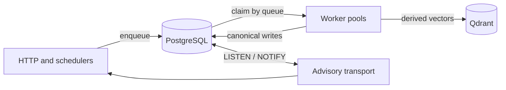

# Jobs and runtime roles

The `topic-stream serve` binary can run three independent roles. With no overrides it runs all three,
which preserves the simple local deployment.

| Role | Enabled by | Owns |
| --- | --- | --- |
| HTTP | `TOPIC_STREAM_HTTP_SERVER_ENABLED` | REST, SSE, one selected Workspace |
| Schedulers | `TOPIC_STREAM_SCHEDULERS_ENABLED` | Source polling, Digest schedules, calibration repair for one selected Workspace |
| Workers | `TOPIC_STREAM_WORKERS_ENABLED` | Five global queue pools and global Feed/projection/model reconciliation for every Workspace |

`TOPIC_STREAM_WORKSPACE_ID` is required when HTTP or schedulers are enabled. A worker-only replica must
leave it unset: tenant identity comes from the claimed PostgreSQL Job row.

## Queue ownership

Every typed Job Definition owns its kind, arguments version, Queue, and retry policy. The persisted
Queue selects exactly one pool:

| Queue | Job kinds | Default concurrency | Retry policy |
| --- | --- | ---: | --- |
| `fetch` | `sync-source`, `sync-all-sources` | 4 | 5 attempts, 30 s base, 1 h cap |
| `generation` | `generate-digest`, `summarize-item` | 1 | 3 attempts, 30 s base, 15 min cap |
| `retrieval` | `index-item`, `calibrate-topic` | 2 | 5 attempts, 5 s base, 5 min cap |
| `feed-preparation` | `prepare-feed` | 2 | 5 attempts, 5 s base, 5 min cap |
| `maintenance` | `reindex-workspace`, `import-workspace` | 1 | 3 attempts, 1 min base, 30 min cap |

Fetch clients share a process-wide limiter within the source reader. The default permits one active
request per upstream hostname; a permit is held until the response body closes.

Claims require `available_at <= now`, order by availability, creation time, and ID, and use
`FOR UPDATE SKIP LOCKED`. The claimed row supplies the authoritative Workspace ID to
`jobs.Execution`, together with its actual lease owner; a payload cannot select another tenant.

## Lazy Workspace runtime

The first Job claimed for a Workspace builds that Workspace's handler graph. The graph freezes no
global Workspace: it owns Workspace-scoped Settings access, retrieval operations, ranking services,
and handlers, while sharing PostgreSQL, Qdrant, the Settings cache, and outbound fetch limits.
Concurrent first Jobs share one initialization. A transient initialization failure follows the
Job's Queue retry policy. Successfully built handlers stay isolated by Workspace.

## Retry, leases, and shutdown

Retry delay is exponential equal jitter in the interval from half-delay through full-delay. A typed
Retry After failure can request a later attempt, bounded by the Queue cap, without sleeping in a
worker. Permanent failures become `dead` immediately.

Workers back off after transient claim or heartbeat store failures. A lost or expired lease cancels
the handler and prevents stale finalization. Shutdown stops new claims, cancels owned executions,
returns interrupted work to `retry_wait`, and joins worker goroutines within the process deadline.

## Live settings and advisories

The Settings cache stores immutable snapshots by Workspace. Each Feed, Search, Ranking, or Digest
operation reads one snapshot and uses it for the entire operation. A successful settings update
commits a `settings.changed` notification in the same PostgreSQL transaction; other replicas reload
that Workspace and version.

Each explicit Item Summary attempt captures its own settings snapshot at execution start. Admission
stores only Item/input identity, so a queued Job can use newer Summary settings when it starts.
Summary calls and publication are independent of Digest generation; see [Item summaries](item-summaries.md).

The same transport carries `jobChanged`, `digestReady`, and `feedInvalidated`. Product notifications
contain only Workspace and resource identity and use a bounded, non-blocking `PublishQueue`; delivery
is best effort. Local and received notifications reach only SSE subscribers for the selected
Workspace, while workers publish notifications for every Workspace.

The PostgreSQL adapter owns a dedicated listener connection. Each attempt first commits `LISTEN`,
then signals readiness so the advisory module reloads cached settings before consuming notifications.
This ordering covers both startup and reconnect gaps. A failed settings load preserves the last
snapshot and retries through a new subscription attempt; one Workspace's load failure does not stop
other cached Workspaces from being refreshed. Operations can continue using their last snapshot.

Listener or notification-handler failure closes current SSE connections. New connections remain
allowed during recovery and are closed again after the subscription and settings reload succeed,
so clients refetch REST state after the entire missed interval. Listener retries use exponential
backoff capped at 30 seconds and reset after successful recovery. Cancellation joins the transport
loops and closes the dedicated connection with an independent cleanup deadline.

## Shared Feed preparation

Worker-role Feed and projection reconcilers scan globally, including Workspaces without an HTTP or
scheduler replica. The projection reconciler reconstructs missing `index-item` enqueue from durable
pending revisions. Serving completion atomically requests candidate work. The Feed reconciler
coalesces from the first dirty change for one minute and enqueues one active `prepare-feed` Job per
Workspace. It runs independently of Source/Digest schedules.

Each successful Job prepares at most eight Topics and replaces bounded ready lists under actual
claim/input/head fences. Remaining or newly requested work continues through another successful
Job. Expired leases cannot commit; incompatible settings/Topic/model/gate inputs cannot overwrite
current lists. Future-date and candidate-expiry boundaries create work without new ingestion.
Preparation never advances the publication head. Capacity is operator configuration through
`TOPIC_STREAM_WORKER_FEED_PREPARATION_CONCURRENCY`, default two, rather than Workspace preferences.

## Projection recovery and startup

Building HTTP or worker dependency graphs does not enumerate or enqueue the pending projection
backlog. Worker-role projection reconciliation owns lost-enqueue recovery. Each pass first selects
one eligible Serving/current-transition Workspace/model destination, then inspects at most 100
pending Item keys in model-index order before checking current revisions/generations and active Job
idempotency keys. Empty destinations advance the destination cursor; inactive retained destinations
never enter this scan. The cursor advances through inspected active or stale keys as well as
new submissions, avoiding repeated scans of a queued prefix. It wraps after the end of the pending
set and restarts from the beginning after a process restart. The durable pending rows and active
Job uniqueness remain authoritative; cursor state is only an efficiency aid.

The cursor advances after successful enqueue of the page. A failed enqueue retries that page,
with active Job deduplication covering any already committed submissions. Calls on one reconciler
are serialized. The normal worker loop retains its one-second interval and 100-key batch bound.
HTTP readiness therefore does not depend on completing backlog repair.

## Model selection and recovery

The latest Desired Model replaces an older queued/running transition without waiting for provider
I/O. Settings atomically advance `selection_generation`, retain the selected checkpoint, supersede
old execution metadata and request cancellation. Version-3 `reindex-workspace` arguments capture
model ID, selection generation and explicit-rebuild intent. Begin, seed, ACK, cleanup and activation
check the current selection/model generation and actual unexpired execution lease.

Seed cursor/completion belongs to the Workspace/model rather than its Job. Returning with no changes
performs no canonical seed; returning with changes drains only pending latest revisions. Three
models are retained without TTL, with Serving protected and the other slots following selection
recency. Eviction cleanup is bounded and never deletes the shared Qdrant collection.

Each blocking synchronization step receives the remaining five-minute no-progress window. Seed or
successful delivery extends it; heartbeats do not. Healthy runs have no total deadline. Existing
maintenance retry policy remains three attempts, one-minute base and thirty-minute cap. Cleanup has
an independent five-second deadline, and Qdrant RPCs have a one-minute upper bound respecting any
earlier caller deadline.

The worker model reconciler uses indexed positive maintenance requests, at most 100 Workspaces per
pass, to recover selection/enqueue gaps and clear terminal/cancelled transition pointers without
handler defers. Terminal request history prevents automatic resurrection; explicit retry remains
available. Collection replacement advances a new recovery request and invalidates old execution.

Admission binds each version-3 model Job to its Workspace, target and selection generation in
`model_transition_jobs`. `latest_transition_job_id` retains the latest admitted operation independently
of the working `transition_job_id`; terminal cleanup clears only the working pointer. A new selection
clears the latest reference. Public retrieval status and Job metadata derive identity and Retry
eligibility from these verified bindings, current Settings and current selection, without exposing
Job payloads or reconstructing identity from model names. A selected, unready model with no admitted
operation reports `waiting`.

The retrieval-owned Retry handler locks the shared Feed head, retrieval state and source Job before
checking current selection, latest Job and terminal status. It admits one replacement atomically
with its binding and latest reference. Repeated Retry of the old source then conflicts. The
replacement resumes the model checkpoint and captures only remaining work, preserving old counters.
An explicit rebuild interrupted before its first Begin retains its reset intent; one already begun
resumes without resetting again. Begin also checks the latest admitted Job so a late obsolete worker
cannot reclaim the same selection. A cancelled/exhausted current operation remains visible until
replaced or superseded, including when no previous Serving model exists.

Every Manager operation reads durable Serving state and captures a consistent model/registry-version/
endpoint/collection snapshot. Runtime caching does not establish authority. Before/after collection
checks reject replaced-instance results; read-only tooling never creates or stamps collections.
These checks work across HTTP/worker processes without advisory delivery. A same-instance explicit
rebuild keeps Serving available; a lost instance reports unavailable until complete recovery.

## Indexing progress

`GET /api/v1/jobs/{jobId}` and Job List expose optional `progress` for `reindex-workspace`:
`phase`, `processedItems`, nullable `totalItems`, and `updatedAt`. The total is unknown before
preparation. A new operation captures its initial required Item set once; a retained model captures
only remaining pending work, including the unseeded suffix of interrupted initialization. New Items
do not increase this total. The one-time membership capture writes one row per required Item and
is part of Begin's transaction under the shared Feed head before the retrieval-state lock. This
serializes capture with canonical writes and ACKs, preventing invisible membership and lost counts.
Its lock duration and capacity cost must be included in rebuild measurements.

Only an accepted current target ACK removes a cohort member and increments its counter in the same
transaction. Concurrent/repeated ACKs, stale revisions, attempts and model generations cannot count
an Item twice. Later changes to counted Items remain catch-up work. Retry of the same Job preserves
membership and counters; a new Job captures its own remaining work. Cancelled/superseded operations
keep their historical counters. Maintenance removes up to 1000 retired member rows per pass;
automatic retry waits retain their membership.

The phases are `preparing`, `indexing`, `catching_up`, `activating`, and `completed`. Equal counts
finish the initial cohort only: current pending work and fenced activation still determine whether
retrieval can switch. The Job's status remains authoritative for success, failure or cancellation.
Job reads use stored counters and indexed metadata lookup, without recounting the archive.

The worker reuses advisory SSE `jobChanged` with a `jobId`; clients refetch Job REST state. Accepted
ACK batches notify at most once per second per execution, when further durable progress occurs.
Preparation/activation completion and the activating phase notify immediately, so phase changes can
produce several events in a second. Existing Job status notifications (start, finish, cancellation)
remain immediate and are not covered by this progress throttle. This is not a periodic heartbeat or
an event per Item. Provider
writes before a durable ACK do not advance the public counters. Refetch on mount, reconnect and
explicit refresh as with other advisory events; no replay or frontend implementation is added.

For registered ready models, API construction binds Qdrant capabilities without remote version
checks or collection provisioning. First bootstrap registration can still initialize its configured
model; SQL-only fixtures explicitly declare their synthetic model ready to avoid provider probes.
Slow or unavailable derived storage must not delay the database-backed Feed/Jobs API. Collection
checks and provisioning remain in explicit operations and rebuild delivery, with the same model,
revision and incarnation fences. Initial readiness can therefore remain pending until background
initialization or an explicit operation runs; constructors do not establish derived readiness.
