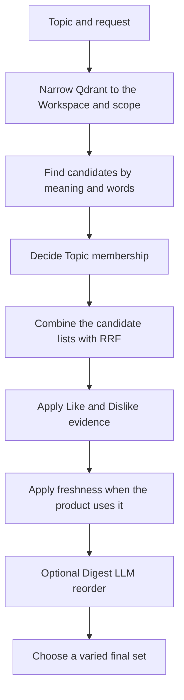
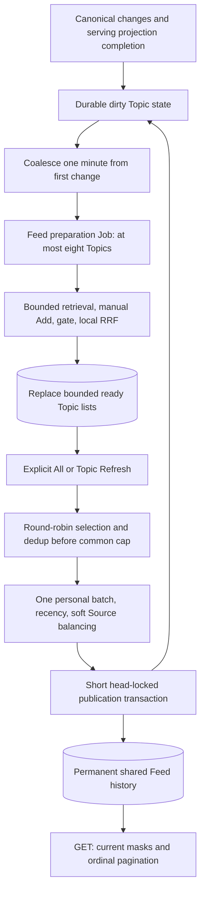
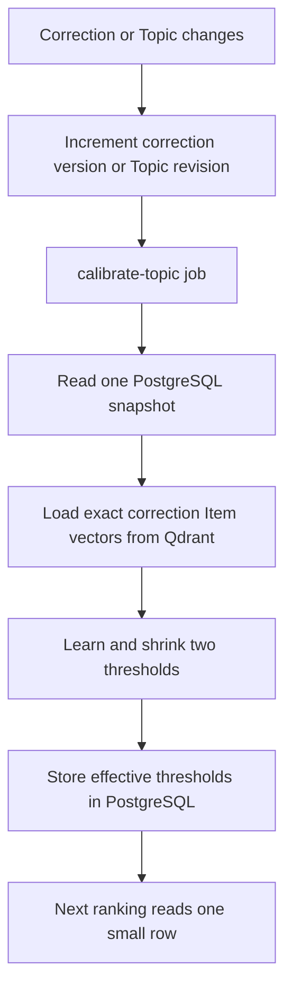
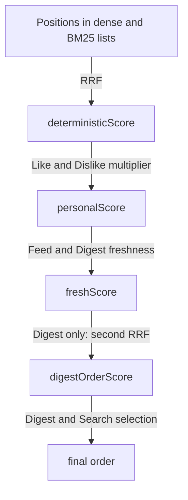

# Ranking and filtering pipeline

This document explains Topic retrieval/membership, common Feed admission, and the independent
Search and Digest pipelines. Feed GET reads saved PostgreSQL Publications and runs none of the
ranking stages below. Feed preparation stops after local fusion; explicit Refresh applies the
remaining deterministic stages once to a common bounded pool.

PostgreSQL is the source of truth. Qdrant contains a rebuildable copy of the fields needed while
searching and ranking. The request path does not reread all feedback or Topic corrections from
PostgreSQL. An asynchronous calibration job reads corrections when they change and materializes
two effective Topic thresholds; the request path reads only that small materialization.

## The complete path



Each arrow carries a list of candidates. A candidate is an Item ID, its current score, the fields
needed by later steps, and small named facts used by `Why this item`.

## Terms used below

- **Dense search** compares vectors produced from text. It can find similar meaning even when the
  exact words differ.
- **BM25** is word-based search. It is useful for exact names such as `MVCC`, `Qwen3`, or `eBPF`.
- **Cosine similarity** measures how closely two vectors point in the same direction. In this
  pipeline a larger value means that two texts are more alike according to the active Embedding
  Model. It is not a probability.
- **RRF** (reciprocal rank fusion) combines ordered lists without pretending their raw scores are
  comparable. An Item at position `r` contributes `weight / (60 + r)`.
- **kNN** means “find the nearest vectors”. Topic Stream uses it only to measure whether a candidate
  resembles Items the user already Liked or Disliked.
- **MMR** chooses relevant Items while avoiding a final set made of near-duplicates.

## Shared Feed preparation, admission, and reading



`candidateLimit` defaults to 50 and is at most 100. Ready storage is bounded by enabled Topics
multiplied by that captured limit. Preparation uses a dedicated pool of two workers by default,
one active Job per Workspace, and at most eight Topics per successful execution. Global worker-role
reconciliation continues remaining work and repairs missed enqueue. Requested/ready/input versions,
first dirty time, the real claim owner/lease, and shared head coordination fence cache replacement.
Never/least-recently prepared Topics take precedence so continuous changes cannot monopolize the
first chunk. Indexed future dates and bounded candidate-list expiry schedule time-only work.

Preparation captures the Serving generation and settings once, reuses Include/Exclude embeddings
for unchanged text/model inputs, and runs steps 1–4. It performs no personal kNN and never publishes.
Feed filters exclude versioned `published`, Hidden, and direct Dislike points before every retrieval
limit. Pending serving projections and current hard eligibility are checked in PostgreSQL too.

All Refresh reads ready metadata and walks local queues round-robin from a varying starting Topic.
Repeated Item IDs consume one common slot. Topic Refresh selects only its queue. Both freeze known
matches from every compatible ready list, without searching missing Topics. All uses cheap RRF of
those local positions; Topic uses its local base score. One personal batch has at most
`2 * candidateLimit` subqueries regardless of Topic count, followed by recency and a soft Source cap.
There is no refill, LLM rerank, or Feed MMR. Enabled cold/empty Topics return saved history without
filler; zero enabled Topics use indexed chronological SQL exclusion before the limit.

The publication transaction revalidates current eligibility/matches, drops consumed or invalid
Items, allocates ordinals, inserts lifetime-unique Workspace+Item facts, removes their candidates
across all Topics, and records projection/refill work atomically. Short/empty admission is valid;
an empty result does not advance the head. Publications retain original matches and explanation
facts. Later Add/Wrong/clear and Hide overlay visibility at the old ordinal; a Dislike affects new
admission. Topic edits do not reclassify history automatically.

A Feed snapshot binds Workspace, Topic selection, format, and common head; its keyset cursor moves
through descending ordinals. Masks apply before the page limit. New publications cannot enter an
older traversal. Content age limits admission to 30 days, with discovery fallback and future-date
waiting; published history has no display TTL. Search and Digest retain their own ranking and do
not acquire publication exclusion. See [Item projection delivery](item-projection.md) for version
fences, payload-only updates, legacy repair, and model activation coordination.

## Inputs fixed at the start

One ranking run first fixes:

1. the Workspace ID;
2. the Serving Embedding Model named by the threshold materialization;
3. the Topic Revision, including its Source scope, Item kinds, mode, Include text, and Exclude text;
4. one pair of effective Include and Exclude thresholds for that Topic and Serving Model;
5. one immutable Workspace Settings snapshot, including `candidateLimit`, RRF, recency,
   diversification, and optional LLM settings;
6. the product path: Feed preparation, common Feed admission, Search, or Digest;
7. the time boundary and requested result count.

These inputs stay unchanged through the whole run. The ranking engine performs one retrieval and
pipeline pass; `candidateLimit` is a work budget, not a promise to fill the requested result count.
Each individual retrieval operation also captures one ready Qdrant generation before embedding or
querying, so a concurrent Model Transition cannot split that operation across two collections.
Model activation remains atomic; later retrieval operations observe either the old or the new
serving generation.

The Topic fields mean:

- **Include** is optional natural-language text describing what belongs in the Topic. Topic Stream
  creates one vector from that exact text and also sends the same text to BM25.
- **Exclude** is optional natural-language text describing content that does not belong. Topic Stream
  creates one vector from that exact text. Exclude does not search for extra candidates; it can
  only reject candidates found by the Include or recent-content path.
- **ordinary mode** prefers not to miss useful Items;
- **strict mode** prefers fewer false matches.

The threshold pair and Workspace Settings snapshot are each loaded once before candidate retrieval.
The operation never recalibrates or rereads Settings inside the ranking request.

Output: stable ranking inputs plus generation-consistent retrieval operations used by the
remaining steps.

## How effective Topic thresholds are prepared

This work happens outside the ranking request.



### Inputs to one calibration

The job reads, in one repeatable PostgreSQL snapshot:

- the current enabled Topic, including its semantic `revision`;
- its `correctionEpoch`, which changes only when all corrections are explicitly cleared;
- its `correctionVersion`, which increases after every effective Add, Wrong topic, or automatic
  correction change;
- only current corrections whose Items still match the Topic's Source and Item-kind scope;
- the Embedding Model named in the job.

Corrections survive ordinary semantic Topic revisions. Clearing them is explicit and advances the
epoch, so a delayed Qdrant projection from the old epoch cannot act as a current override.

The job loads each corrected Item by exact ID from that model's Qdrant collection. It embeds the
Topic's exact Include text and, when present, its exact Exclude text. For every correction it then
builds one labelled sample:

```text
sample = {
    includeCosine: cosine(itemVector, includeVector),
    excludeCosine: cosine(itemVector, excludeVector),
    membership: Add or Wrong topic
}
```

### How `learnedThreshold` is selected

Include and Exclude are learned as two independent binary decisions. For Include, Add is positive
and Wrong topic is negative. For Exclude rejection, Wrong topic is positive and Add is negative.
For every distinct observed cosine value `t`, the algorithm predicts positive when `cosine >= t`
and counts true positives (`TP`), false positives (`FP`), and false negatives (`FN`):

```text
F_beta(t) = (1 + beta^2) * TP
            / ((1 + beta^2) * TP + beta^2 * FN + FP)
```

`F0.5` weights precision more: false positives hurt relatively more. `F2` weights recall more:
false negatives hurt relatively more. The `learnedThreshold` is the observed value with the best
F score. A tie chooses the lower threshold for `beta >= 1` to favor recall, and the higher
threshold for `beta < 1` to favor precision.

The two decisions use:

| Topic mode | Include decision | Exclude-rejection decision |
| --- | --- | --- |
| ordinary | F2: admit broadly | F0.5: reject cautiously |
| strict | F0.5: admit cautiously | F2: reject broadly |

Learning starts only with at least five Add and five Wrong topic corrections. Before that, the
effective value is the model-specific bootstrap threshold. With enough samples, the empirical
value is shrunk toward that bootstrap with prior weight 10:

```text
sampleCount = number of Add corrections + number of Wrong topic corrections

effectiveThreshold =
    (learnedThreshold * sampleCount + bootstrapThreshold * 10)
    / (sampleCount + 10)
```

The job persists the two `effectiveThreshold` values together with model ID, Topic revision,
correction epoch/version, and calibration algorithm version. It may save a result that became
stale only because newer individual corrections arrived while it ran; that row is still safe as a
temporary approximation. It cannot overwrite a row built from a newer correction version, and it
cannot commit across a changed Topic revision or correction epoch.

### Which threshold pair ranking serves

| Stored state | Thresholds used now | Background action |
| --- | --- | --- |
| Same model, algorithm, Topic revision, epoch, and correction version | stored effective pair | none |
| Only stored correction version is older | stored compatible-stale pair | enqueue recalibration |
| Row missing, or model/algorithm/revision/epoch differs | bootstrap pair for Topic mode | enqueue recalibration |

A reconciler checks enabled Topics at startup and every five minutes. Membership-relevant Topic
changes, correction writes, and model cutover also wake it. Jobs use a stable key per Topic and
model, so repeated wakeups coalesce while work is active. Calibration jobs appear in Task Center
like other durable jobs. Model cutover never waits for calibration: the new model starts with
bootstrap thresholds until its rows are built.

## 1. Narrow Qdrant before searching

Every Qdrant request includes the Workspace ID. It also limits Items to the Topic's selected
Sources and Item kinds and to the product's date window. Hidden Items are omitted from Feed and
Digest, but Search may return them with their state.

These checks answer exact questions: “does this Item belong to this Workspace?”, “is its Source
selected?”, and “is it recent enough?”. They are not similarity scores.

Output: a scope/date filter reused by candidate search and Topic membership lookup. Personal
neighbours use their own Workspace/feedback scope, retaining published feedback evidence.

## 2. Find possible candidates

### Topic with Include text

Topic Stream embeds the Topic's Include text, or reuses its compatible prepared embedding. Two bounded
Qdrant searches return separate ordered lists under the filter from step 1:

1. up to `candidateLimit` Items nearest to the Include vector;
2. up to `candidateLimit` Items matching the Include words through BM25.

The two lists stay separate because their raw scores mean different things. The dense result keeps
the candidate vector and its cosine similarity to Include. A BM25-only Item also loads its vector,
because the membership step needs the same evidence for every candidate.

### Topic without Include text

There is no query text to embed or send to BM25. Topic Stream instead takes up to `candidateLimit`
newest Items under the same filter. Their published or discovered time defines their order.

### Manual Add to topic

Current `Add to topic` corrections live in the Qdrant payload. They are the only corrections that
generate extra candidates; `Wrong topic` only rejects an Item already found by another branch.
The separate lookup filters by Topic ID, correction epoch, `membership=include`, and the same scope
as the automatic branches.

Its bounded budget is:

```text
freeSlots = max(0, candidateLimit - uniqueAutomaticCandidateCount)
manualIncludeLimit = min(candidateLimit, max(10, freeSlots))
```

When Include exists, Qdrant returns the nearest corrected Items to the Include vector. Otherwise it
returns the newest corrected Items. Each is merged into the corresponding dense or recent list.
The correction guarantees consideration; it does not manufacture a score bonus or guarantee a top
position.

Output: dense and BM25 candidate lists, or one recent list, plus in-scope manual additions.

## 3. Decide whether each candidate belongs to the Topic

This step runs before RRF. It looks at each distinct candidate once.

### Manual decision first

Every automatically found or manually added candidate carries its correction payload. The ranking
engine accepts only a correction with this Topic ID and current correction epoch:

- `Add to topic` accepts it;
- `Wrong topic` rejects it;
- `automatic` means there is no manual override and similarity rules decide.

An old-epoch correction cannot override the current set. A semantic Topic revision alone does not
discard corrections; the user must explicitly choose the clear policy when editing the Topic.

### Automatic decision

If Include exists, Topic Stream calculates:

```text
includeCosine = cosine(candidateVector, includeVector)
```

The candidate must have `includeCosine >= includeThreshold`.

If Exclude exists, Topic Stream calculates:

```text
excludeCosine = cosine(candidateVector, excludeVector)
```

The candidate must also have `excludeCosine < excludeThreshold`.

If Include is empty, the Include check is absent. If Exclude is empty, the Exclude check is absent.
An Item must pass every check that exists.

Output: the original candidate lists with rejected Items removed and membership facts attached to
accepted Items.

## 4. Combine the search lists with RRF

RRF gives equal weight to the dense and BM25 lists. For a candidate at one-based rank `r`:

```text
contribution = 1 / (60 + r)
rrfScore = sum of contributions from lists containing the candidate
```

An Item found in only one list receives only that list's contribution. Accepted manual additions
participate through the list into which step 2 merged them.

The accepted union is trimmed to the captured `candidateLimit`. Short results remain short;
there is no 50-to-100 retry or refill. Feed saves this local result as a replaceable candidate list,
and personal scoring waits until the later common Refresh selection.

Output: one candidate list ordered by `rrfScore`. From this point forward, each candidate carries
one score named `deterministicScore`.

## 5. Apply personal Like and Dislike evidence

Personal Feedback is not another candidate source. It can only reorder or suppress Items already
accepted by the Topic. This deliberately keeps retrieval bounded and prevents an old Like from
pulling an out-of-topic Item into the result.

Current feedback is already present in the shared Qdrant collection. For all candidates in one
ranking run, Topic Stream sends one Qdrant batch request containing two filtered kNN searches per
candidate:

1. nearest points whose current sentiment is Like;
2. nearest points whose current sentiment is Dislike.

Every search is restricted to the same Workspace. It asks for at most 13 points, removes the
candidate itself if present, and keeps at most 12 neighbours. This is the “12-neighbour query” used
below; it is created here, not in an earlier hidden step. Each returned point contains only its ID,
cosine score, `feedback.sentiment`, and `feedback.updatedAt`; vectors, comments, Topic corrections,
and unrelated Item metadata are not transferred for personal scoring.

Likes and Dislikes activate independently. Like evidence is used once the Workspace has at least
five current Likes. Dislike evidence is used once it has at least five current Dislikes. One side
does not wait for the other.

For each neighbour:

```text
ageDays = max(0, days since that feedback was last changed)
effectiveEvidence = cosineSimilarity * 0.5^(ageDays / 180)
```

Topic Stream sorts the evidence for the candidate, keeps the strongest three Likes and strongest
three Dislikes separately, and takes each side's mean:

```text
positiveEvidence = mean(strongest three effective Like values), or 0
negativeEvidence = mean(strongest three effective Dislike values), or 0
personalMultiplier = max(0, 1 + 0.25*positiveEvidence - 0.50*negativeEvidence)
personalScore = deterministicScore * personalMultiplier
```

A direct Like sets positive evidence to at least 1. A direct Dislike sets negative evidence to at
least 1. In Feed and Digest, a direct Dislike suppresses the candidate. Strong indirect negative
evidence also suppresses it when it is at least 0.80 and stronger than positive evidence, unless a
direct Like rescues it. Search never suppresses a result for personal preference; it only applies
the multiplier.

Topic membership and Personal Feedback answer different questions. `Wrong topic` plus Like rejects
the Item from that Topic. `Add to topic` plus Dislike accepts Topic membership and then suppresses
the Item from Feed or Digest.

Output: the same Topic candidate pool with `personalScore` and evidence facts, minus candidates
suppressed on Feed or Digest.

## 6. Apply freshness where the product uses it

Feed and Digest give recent Items a small bounded lift. Search does not.

```text
age = max(0, now - publishedAt)
freshness = 0.5^(age / 7 days)
freshnessMultiplier = 1 + 0.10*freshness
freshScore = personalScore * freshnessMultiplier
```

A just-published Item receives at most ten percent. The lift halves every seven days. `freshScore`
is the deterministic order passed to later Digest stages; there is no separate undefined
`deterministicRank` value.

Output: candidates ordered by `freshScore` for Feed and Digest, or by `personalScore` for Search.

## 7. Optionally let an LLM reorder a Digest shortlist

This step exists only for Digest and is disabled by default. It cannot add an Item rejected earlier.

Topic Stream takes the deterministic shortlist:

```text
shortlistSize = min(60, max(30, 3 * Topic item limit))
```

The Preference Profile is loaded once for the whole Digest, not once per Topic. To choose feedback
examples, Topic Stream takes the union of all Topic shortlists, removes duplicate Item IDs, measures
each feedback Item against every shortlisted candidate, and keeps the maximum cosine. It then loads
the canonical Item and current feedback from PostgreSQL for the three most relevant Likes and three
most relevant Dislikes across the whole Digest. An example is skipped if its feedback was removed
or changed polarity after the Qdrant projection was read. The current PostgreSQL feedback supplies
the optional comment sent to the LLM.

The LLM receives the frozen Topic Revision, the Preference Profile, those examples, and candidate
summaries. It returns only an ordering of the supplied candidate IDs. Comments are visible only to
this LLM step; deterministic scoring never interprets them.

Topic Stream combines the deterministic and LLM orders with a second RRF:

```text
digestOrderScore =
    1.0 / (60 + deterministicPosition)
  + 0.5 / (60 + llmPosition)
```

Invalid output, timeout, or provider failure discards the LLM order and preserves the deterministic
order.

Output: the same shortlist in a possibly refined order.

## 8. Choose the final set

Feed applies its soft Source cap once to the common admission Batch, with a default of three.
Overflow moves behind alternatives rather than being discarded. The resulting order is saved;
page boundaries do not rerank it or apply Source balancing again.

Digest uses MMR with default `lambda = 0.75`:

```text
mmrValue =
    0.75 * normalizedRelevance
  - 0.25 * greatest cosine similarity to an already selected Item
```

It also applies a soft maximum of two Items from one Source inside the Topic section. If exploration
is enabled and the Topic limit is at least five, one eligible Item without personal evidence may
occupy the last position. It still must have passed the Topic membership step.

Search uses MMR to reduce near-duplicates but does not apply freshness or Source balancing.

Output: the final ordered Item IDs and their compact explanation facts.

## Score lifecycle



The diagram names every value at the point where it first exists. Stages that do not apply simply
pass the previous score and order onward.

## What is stored after ranking

Feed stores permanent Publication facts: Batch, timestamp, ordinal, original matched Topics,
input/model versions, admission score and compact signals. It references canonical Items rather
than copying content. Search responses remain transient. An immutable Digest Issue stores selected
display data, Topic Revision, score facts, and versions. None creates a generic ranking-run log.

This storage is not operational logging. PostgreSQL continues to own Items, feedback, corrections,
settings, and Digest Issues. Qdrant remains a replaceable search projection.

## Projection freshness and failure

Every change that affects retrieval receives a new opaque projection revision and monotonic
version in the same PostgreSQL transaction as the canonical change. Topic Stream then tries to deliver that exact snapshot
to every Qdrant collection currently serving or being built for the Workspace.

If delivery fails, PostgreSQL keeps one latest pending delivery for each Workspace, Item, and
Embedding Model. A later identical user action does not change `updatedAt` or invent another
revision; it retries the pending delivery. Global worker-role indexing reconciliation repairs
missed enqueue, including publication and visibility changes. Unchanged text/model permits full
payload replacement without another embedding. Conditional writes and verified acknowledgement
prevent an older delivery from erasing newer fields. Ranking never treats Qdrant as the authoritative copy.

Until the pending revision reaches Qdrant, the API reports that the canonical choice was saved but
its retrieval projection is pending. A Model Transition cannot cut over while its target has pending
deliveries.

## Product path summary

| Path | Candidate source | Personal suppression | Freshness | LLM | Final selection |
| --- | --- | --- | --- | --- | --- |
| Topic Feed Refresh | one compatible ready Topic list | once on common pool | yes | no | saved admission order and soft Source cap |
| All Feed Refresh | balanced ready lists, deduplicated before common cap | once on common pool | yes | no | cross-Topic RRF, saved admission order |
| Feed GET | saved PostgreSQL Publications | no new scoring | no new scoring | no | immutable ordinal order with current masks |
| Digest | each configured Topic independently | yes | yes | optional | MMR, Source cap, optional exploration |
| Search with text | search-text dense/BM25 | no; reorder only | no | no | MMR |
| Empty Search | newest-first archive | no; reorder only | no | no | archive order |

## Versioned parts

Responses and Digest Issues identify the versions of the Topic gate, personal scoring, RRF
parameters, freshness rule, optional prompt/model, and final selection rule. Changing a formula or
default requires a version change so two explanations never silently refer to different behavior.

### Saved Feed read access

`feed_publications` keeps immutable admission facts. `feed_display_entries` is a synchronous PostgreSQL
access set containing only currently visible, All-eligible publication keys, their saved ordinal and
original-plus-Add-minus-Wrong Topic identifiers. Ordinal and Topic GIN indexes select a bounded page
before canonical Markdown hydration. This avoids scanning long hidden or all-Wrong history prefixes.

Publication, visibility, correction writes, correction clearing and Topic deletion maintain affected
access rows in the same transaction under the Workspace Feed head lock. There is no asynchronous
visibility window. A deleted original Topic identifier may remain in the access array: Topic reads
check current Topic existence and hydration filters current membership. Deletion alone never becomes
Wrong. Clear/delete and restore reinstate the original ordinal; an empty original match array remains
eligible for All. Search continues to read canonical state independently.
